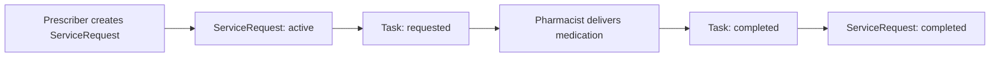

# 🏥 UHMEP (Referral Prescription) FHIR Mock API Server

A single-file, self-contained mock API server implementing the Belgian **UHMEP v1.4** (Universal Healthcare Medication e-Prescription) and **Recip-e FHIR R4** specifications.

Designed specifically for **hackathons and software engineers** who want to build applications on top of Belgian eHealth prescription workflows without dealing with complex PKI certificates, OAuth2 token exchanges, or healthcare IT infrastructure.

---

## ⚡ Quickstart

### Prerequisites
* Python 3.12+
* [`uv`](https://docs.astral.sh/uv/) (installed via `curl -LsSf https://astral.sh/uv/install.sh` or `brew install uv`)

### Run the Server
You can run the script directly with `uv` (it will automatically install FastAPI, Uvicorn, and dependencies):

```bash
# Direct execution (executable script)
./server.py

# Or via uv
uv run server.py
```

### Run Automated Tests
```bash
# Execute comprehensive test suite
./test_server.py
```

### Server Endpoints & UIs
Once running, the mock server is available at:
* 📖 **Interactive Swagger UI**: [http://localhost:8000/docs](http://localhost:8000/docs)
* 📚 **ReDoc Documentation**: [http://localhost:8000/redoc](http://localhost:8000/redoc)
* 📋 **OpenAPI JSON**: [http://localhost:8000/openapi.json](http://localhost:8000/openapi.json)
* 🩺 **FHIR CapabilityStatement**: [http://localhost:8000/metadata](http://localhost:8000/metadata)
* 📦 **Fixtures Summary**: [http://localhost:8000/fixtures/summary](http://localhost:8000/fixtures/summary)

---

## 🛠️ CLI Options

| Flag | Default | Description |
| :--- | :--- | :--- |
| `--port <PORT>` | `8000` | Port to listen on |
| `--host <HOST>` | `0.0.0.0` | Host address to bind |
| `--db <PATH>` | `uhmep_mock.db` | Path to SQLite database file |
| `--reset-db` | `false` | Force reset and reload default Belgian fixtures on start |
| `--reload` | `false` | Enable live reload for code development |

```bash
# Example: run on port 8080 with a clean database reset
./server.py --port 8080 --reset-db
```

---

## 🏗️ Design Principles & Grill-Me Interview Log

During the planning and design phase of this mock server, the requirements and architectural boundaries were refined through a systematic interview (`/grill-me`). The decisions recorded below guide the implementation:

### 1. Framework & Runtime Architecture
* **Question**: Which Python framework and runner architecture would you like to use for the single-file mock API server?
* **Agreed Decision**: **FastAPI + Uvicorn with a `uv` PEP 723 inline script header** (`#!/usr/bin/env -S uv run`).
* **Design Rationale**: Provides built-in Swagger UI at `/docs`, automatic OpenAPI v3 documentation, Pydantic validation, and rapid zero-setup execution without requiring manual virtualenv management.

### 2. API Surface & Endpoint Coverage
* **Question**: How should the mock server handle the API surface defined in [UHMEP_v1_4-openapi.json](file:///usr/local/google/home/kciredor/src/solve/assets/UHMEP_v1_4-openapi.json) versus the cookbook references?
* **Agreed Decision**: **Implement all endpoints defined in UHMEP v1.4** (`/metadata`, `/ServiceRequest`, `/Task`, `/Practitioner`, `/PractitionerRole`, `/Organization`, `/GraphDefinition`, `/OperationDefinition`) and include **optional alias routes for `/MedicationRequest`**.
* **Design Rationale**: In Belgian eHealth FHIR v1.4, `ServiceRequest` and `Task` are the canonical prescription resources, but earlier documentation and generic FHIR tutorials often refer to `MedicationRequest`. Supporting both prevents friction during hackathon coding.

### 3. Role Simulation & Fake Authentication
* **Question**: How should role simulation and lightweight fake authentication be configured for hackathon participants?
* **Agreed Decision**: **Dual header support (`X-Role` / `Authorization: Bearer <role>`) with default unrestricted access (`prescriber`) if omitted.**
* **Design Rationale**: Production eHealth systems require complex PKI certificates and token exchanges that distract from application building. Allowing simple role toggles while defaulting to unrestricted access gives developers full control with zero friction.

### 4. Database Persistence & Fixture Management
* **Question**: How should SQLite database persistence, fixture initialization, and data resets be managed?
* **Agreed Decision**: **Auto-create a local `uhmep_mock.db` on startup seeded with standard Belgian FHIR fixtures, plus `--reset-db` CLI flag and `POST /fixtures/reset` endpoint.**
* **Design Rationale**: Developers need real data immediately upon launching the server, as well as an easy way to wipe and restore baseline state when experimenting with state mutations (cancelling, dispensing).

### 5. Content Negotiation & FHIR Response Standards
* **Question**: How should content negotiation, search formats, and FHIR response structures be handled?
* **Agreed Decision**: **Prioritize JSON (`application/fhir+json` and standard `application/json`), accept query params, JSON, or form-urlencoded for `_search` endpoints, return standard FHIR `OperationOutcome` on errors, and include `Correlation-Id` and `Content-Be-Pseudo` response headers.**
* **Design Rationale**: Adheres strictly to FHIR R4 conventions while remaining permissive and forgiving to client HTTP libraries (curl, fetch, Axios, requests).

### 6. Business Logic & Workflow Simulation
* **Question**: What level of business logic simulation (status workflows, operations, and validation) should the mock server provide?
* **Agreed Decision**: **Interactive simulation of status lifecycles (`active` → `completed` / `cancelled` / `stopped`), custom operations (`$approve`, `$reject`, `$graph` graph bundle assembly), and helpful validation feedback via FHIR `OperationOutcome`.**
* **Design Rationale**: Enables participants to build end-to-end workflows (e.g. pharmacist dispensing automatically completes prescription) without rejecting valid exploratory payloads.

### 7. Documentation Scope & Style
* **Question**: What scope and style should the README.md emphasize to best support hackathon participants?
* **Agreed Decision**: **Comprehensive guide with a non-healthcare primer (explaining FHIR, Belgian eHealth terms, SSIN/NIHII, prescriptions vs tasks), role matrix & capabilities, sample curl / HTTP requests for typical workflows, and database reset instructions.**
* **Design Rationale**: Bridges the knowledge gap for software engineers unfamiliar with medical informatics and Belgian healthcare regulations.

---

## 🩺 Healthcare & Belgian eHealth Primer for Engineers

If you are new to healthcare interoperability and the Belgian eHealth ecosystem, here is what you need to know:

### 1. What is FHIR?
**FHIR (Fast Healthcare Interoperability Resources)** is the modern RESTful JSON standard created by HL7 for exchanging healthcare data. Instead of arbitrary JSON objects, data is modeled as standardized **Resources** (e.g., `Practitioner`, `Organization`, `ServiceRequest`, `Task`, `Bundle`).

### 2. ServiceRequest vs. Task (The Prescription Lifecycle)
In the Belgian UHMEP / Recip-e architecture:
* **`ServiceRequest`** (or `MedicationRequest`): Represents the **clinical prescription itself** created by a prescriber (doctor/dentist). It specifies the medication, dosage instructions, patient, and validity period.
* **`Task`**: Represents the **action / fulfillment tracking** for the prescription. When a doctor creates a `ServiceRequest`, an associated `Task` is created in `requested` status. When a community pharmacist dispenses the medication to the patient, they update the `Task` to `completed`, which in turn marks the `ServiceRequest` as `completed`.



### 3. 🔍 Why are Most Endpoints Detail & Create? (The FHIR Search Paradigm)

Software engineers accustomed to standard REST APIs often wonder: *“Why is there no generic `GET /ServiceRequest` or `GET /Practitioner` to list all records with query parameters?”*

There are three architectural and legal reasons for this in FHIR and Belgian eHealth:

#### A. Dedicated Search via `_search`
In HL7 FHIR, filtered listings are handled through dedicated search endpoints:
* **Prescriptions**: `POST /ServiceRequest/_search` (or `POST /MedicationRequest/_search`)
* **Tasks**: `GET /Task?focus=...` and `POST /Task/_search`

> **Why `POST` for searching?** In healthcare, search queries often pass long pseudonymized tokens (e.g., `urn:be:fgov:ehealth:pseudo:v1:pat-1001-jane-doe`) or encrypted payloads. Sending these via `POST` in the request body prevents URL length limit issues and ensures sensitive patient identifiers do not leak into web proxy or access logs.

#### B. Privacy & GDPR: No Unbounded Data Dumps
In healthcare, **unbounded queries are forbidden by design**. You cannot perform an unrestricted `GET /ServiceRequest` to dump all prescriptions in the database. Every search query **must** be scoped to a specific patient (`patient=...`), prescriber (`requester=...`), or prescription focus (`focus=...`).

#### C. Transaction Hub vs. Authentic Source of Truth (CoBRHA)
For resources like `Practitioner`, `PractitionerRole`, and `Organization`:
* **UHMEP is a prescription transaction hub**, not the federal directory of healthcare providers.
* The authentic source of all licensed Belgian doctors, pharmacists, and hospitals is **CoBRHA**.
* Therefore, UHMEP only provides detail lookups (`GET /Practitioner/{id}`, `GET /Organization/{id}`) so clients can resolve references attached to a specific prescription.

---

### 4. Key Identifiers in Belgian Healthcare
* **SSIN / NISS / INSZ**: The 11-digit Social Security Identification Number (e.g., `90010212345`) assigned to every Belgian citizen.
* **NIHII / INAMI / RIZIV**:
  * **Professional (11 digits)**: Identifies healthcare professionals (e.g., `19766016004` for physicians, `20017534001` for pharmacists).
  * **Organization (8 digits)**: Identifies healthcare facilities (e.g., `71000123` for hospitals, `56009876` for pharmacies).
* **CBE / KBO (10 digits)**: Belgian Enterprise Number for businesses and institutions (e.g., `0419052272`).
* **AMPP & CNK Codes**: Belgian national drug codes identifying specific packaged medicines (e.g., `0345678` for Omeprazol Sandoz 20mg 28 caps).

### 5. Pseudonymization
To protect patient privacy, real patient SSINs are never stored in plain text in the prescription hub. Instead, they are pseudonymized into deterministic tokens with the prefix:
`urn:be:fgov:ehealth:pseudo:v1:<token>`

The mock server accepts and generates these standard pseudonyms automatically.

---

## 👥 Role Simulation & Capabilities Matrix

In production, eHealth uses OAuth2 tokens with digital ID cards (eID / itsme). For this hackathon environment, **authentication is completely optional and non-blocking**.

To simulate different roles, pass the `X-Role` header (or `Authorization: Bearer <role>`):

| Role | Intended Actor | Capabilities |
| :--- | :--- | :--- |
| `prescriber` *(default)* | General Practitioners, Dentists, Specialists | Create prescriptions (`POST /ServiceRequest`), view patient prescription history, cancel prescriptions, view full relation graph (`$graph`), approve/reject requests. |
| `caregiver` / `pharmacist` | Community Pharmacists, Hospital Dispensaries | Search open prescriptions for patients (`_search`), claim & fulfill dispense tasks (`PATCH /Task/{id}`), deliver medication, complete prescriptions. |
| `patient` | Citizens / Patients | View their own active and past prescriptions (`GET /ServiceRequest/{id}`), view fulfillment status and dispensing pharmacy. |
| `organization` | Hospitals, Pharmacy chains, Lab centers | Batch queries, departmental task fulfillment, institutional audits. |

> **Note**: If no role header is sent, the server defaults to `prescriber` with unrestricted access.

---

## 🗄️ Pre-Seeded Test Fixtures

The server comes pre-populated with realistic Belgian healthcare test data:

### Practitioners & Roles
| ID | Name | Profession | NIHII (INAMI) | Associated Role |
| :--- | :--- | :--- | :--- | :--- |
| `practitioner-dr-dupont` | Dr. Jean Dupont | Physician | `19766016004` | `role-physician-dupont` (Saint-Luc) |
| `practitioner-dr-claes` | Dr. Marie Claes | Physician / GMD | `19876543001` | `role-physician-claes` |
| `practitioner-dr-peeters` | Dr. An Peeters | Dentist | `18543219002` | — |
| `practitioner-pharm-janssen`| Hendrik Janssen | Pharmacist | `20017534001` | `role-pharmacy-janssen` (Apotheek Janssen) |

### Organizations
| ID | Name | Type | NIHII / CBE |
| :--- | :--- | :--- | :--- |
| `org-hopital-saint-luc` | Cliniques Universitaires Saint-Luc | Hospital | NIHII: `71000123`, CBE: `0419052272` |
| `org-apotheek-janssen` | Apotheek Janssen Brussel | Pharmacy | NIHII: `56009876`, CBE: `0434567890` |
| `org-apotheek-centrum-antwerpen`| Apotheek Centrum Antwerpen | Pharmacy | NIHII: `56001234` |

### Sample Patients & Prescriptions
| Prescription ID | Patient Pseudonym | Medication | Status |
| :--- | :--- | :--- | :--- |
| `sr-ciclosporin-001` | `urn:be:fgov:ehealth:pseudo:v1:pat-1001-jane-doe` | Neoral 100 mg/ml oral solution 50 ml | `active` |
| `sr-paracetamol-002` | `urn:be:fgov:ehealth:pseudo:v1:pat-1001-jane-doe` | Dafalgan Pediatrie 30 mg/ml 90 ml | `completed` |
| `sr-ibuprofen-003` | `urn:be:fgov:ehealth:pseudo:v1:pat-1002-marc-willems` | Nurofen 20 mg/ml suspension 100 ml | `cancelled` |
| `sr-dexamethasone-004` | `urn:be:fgov:ehealth:pseudo:v1:pat-1002-marc-willems` | Dexamethason 1 mg/ml oral solution | `stopped` (course completed) |
| `sr-omeprazole-005` | `urn:be:fgov:ehealth:pseudo:v1:pat-1003-elena-vandenberg` | Omeprazol 20mg 28 caps | `active` |
| `sr-mercaptopurine-006` | `urn:be:fgov:ehealth:pseudo:v1:pat-1001-jane-doe` | !PURI Mercaptopurine 10 mg/ml (magistral) | `draft` |
| `sr-atovaquone-007` | `urn:be:fgov:ehealth:pseudo:v1:pat-1003-elena-vandenberg` | Wellvone 750 mg/5 ml suspension | `active` |

---

## 🚀 API Cookbook & Code Examples

### 1. Check Server Capabilities
```bash
curl -X GET http://localhost:8000/metadata
```

### 2. Search & Filter Active Prescriptions for a Patient

> [!NOTE]
> **Why `application/x-www-form-urlencoded`?** This is by design: the [HL7 FHIR specification](https://hl7.org/fhir/http.html#search) and the Belgian eHealth UHMEP cookbook define `POST /[type]/_search` request bodies as URL-encoded key-value pairs (`application/x-www-form-urlencoded`) while returning standard FHIR `application/fhir+json` bundles. For hackathon convenience, this mock server also accepts JSON payloads and URL query parameters.

**Option A: Standard FHIR URL-Encoded Body**
```bash
curl -X POST http://localhost:8000/ServiceRequest/_search \
  -H "Content-Type: application/x-www-form-urlencoded" \
  -d "patient=pat-1001-jane-doe&status=active"
```

**Option B: JSON Body (Developer-Friendly)**
```bash
curl -X POST http://localhost:8000/ServiceRequest/_search \
  -H "Content-Type: application/json" \
  -d '{"patient": "pat-1001-jane-doe", "status": "active"}'
```

**Option C: URL Query Parameters**
```bash
curl -X POST "http://localhost:8000/ServiceRequest/_search?patient=pat-1001-jane-doe&status=active"
```

### 3. Retrieve Complete Prescription Graph ($graph)
The `$graph` operation returns the prescription bundled together with the requesting doctor, clinic organization, and associated fulfillment task:

```bash
curl -X GET http://localhost:8000/ServiceRequest/sr-ciclosporin-001/\$graph
```

### 4. Create a New Prescription
```bash
curl -X POST http://localhost:8000/ServiceRequest \
  -H "Content-Type: application/fhir+json" \
  -d '{
    "resourceType": "ServiceRequest",
    "status": "active",
    "intent": "order",
    "priority": "routine",
    "code": {
      "coding": [
        {
          "system": "https://www.ehealth.fgov.be/standards/fhir/medication/NamingSystem/ampp",
          "code": "0456789",
          "display": "Augmentin 875mg/125mg comp 20"
        }
      ],
      "text": "Augmentin 875mg/125mg"
    },
    "quantityQuantity": {
      "value": 1,
      "unit": "package"
    },
    "subject": {
      "identifier": {
        "system": "https://www.ehealth.fgov.be/standards/fhir/core/NamingSystem/ssin",
        "value": "urn:be:fgov:ehealth:pseudo:v1:pat-1001-jane-doe"
      }
    },
    "requester": {
      "reference": "PractitionerRole/role-physician-dupont",
      "display": "Dr. Jean Dupont"
    },
    "note": [
      {
        "text": "1 tablet twice daily for 7 days"
      }
    ]
  }'
```

### 5. Pharmacist Dispenses Medication (Fulfilling Task)
Updating the fulfillment task to `completed` automatically transitions the linked prescription to `completed`:

```bash
curl -X PATCH http://localhost:8000/Task/task-dispense-001 \
  -H "Content-Type: application/json" \
  -d '{
    "status": "completed",
    "owner": {
      "reference": "PractitionerRole/role-pharmacy-janssen"
    }
  }'
```

### 6. Resetting the Database
To reset the SQLite database back to its clean initial state with all default fixtures:

```bash
curl -X POST http://localhost:8000/fixtures/reset
```

---

## 📂 Project Structure

```
.
├── server.py             # Single-file runnable FastAPI mock server & SQLite engine
├── test_server.py        # Automated test suite (all endpoints, operations, workflows)
├── README.md             # Developer guide, domain primer, role matrix, and cookbook
├── assets/
│   ├── UHMEP_v1_4-openapi.json                    # Official Belgian UHMEP v1.4 OpenAPI Spec
│   └── UHMEP-MedicationPrescription-Cookbook.pdf  # Belgian eHealth Prescription Implementation Cookbook
└── uhmep_mock.db         # Auto-generated SQLite database file (created on first run)
```
